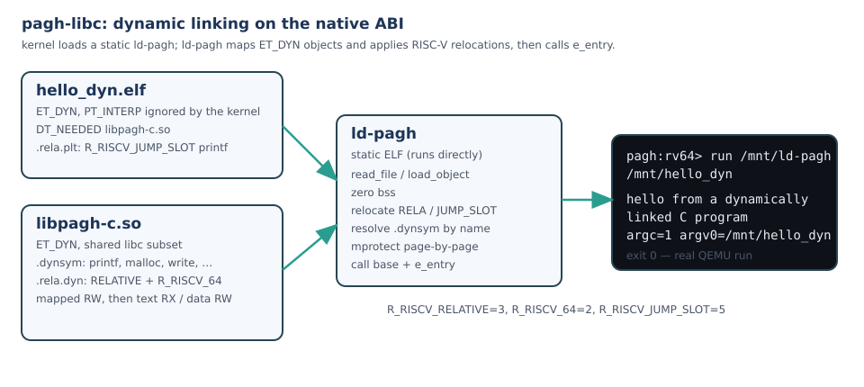

# pagh-libc — C runtime and libc subset for pagh-riscv

A freestanding C library for the **native pagh-riscv ABI** (not Linux compat):
`crt0`, raw `ecall` syscalls, `malloc` over `brk`, `string`, `stdio`/`printf`,
`unistd` (`read/write/open/close/lseek`), `stat`, `dirent`, `time`, `exit`.

It is what lets C programs run on pagh: compile with the xPack RISC-V GCC,
link against this library, and `run /mnt/hello`. It is **not glibc** — it is a
small, auditable C runtime for a hobby OS. It also ships the userland dynamic
loader `ld-pagh` and, since 0.9.0, a runtime `dlopen`/`dlsym` API in the shared
libc; 0.10.0 makes that API follow the new object's `DT_NEEDED` recursively and
adds the `RTLD_GLOBAL`/`RTLD_LOCAL` scopes and `RTLD_DEFAULT`/`RTLD_NEXT`
lookups. **0.11.0** added the BSD socket subset over kernel 0.17/0.18 (TCP
client, listener and `accept`, UDP datagrams, the ABI's `sockaddr_in`, `inet_*`
and byte-order helpers), a minimal DNS A-record resolver over UDP
(`gethostbyname` and a `getaddrinfo`-lite), exact `%f`/`%e`/`%g` float
formatting, and `strerror`/`perror`. **0.12.0** adds userland TLS 1.3 over
kernel 0.21: `getrandom` and the `pagh_tls_*` wrappers over syscalls 1100-1103
(`tls_connect`/`tls_write`/`tls_read`/`tls_close`), plus `https_get`. The
handshake is the kernel's, and so is the trust decision: the wrappers expose no
flag that could relax certificate verification. **0.13.0** adds the command-line
and string helpers a ported program expects: `getopt`/`getopt_long`/
`getopt_long_only` (permutation, long-option abbreviations, `--`, `:`-style
errors), `bsearch`, the reentrant `strtok_r`/`strsep` with their `strspn`/
`strcspn` primitives, `memchr`, and `getline`/`getdelim` with `feof`/`ferror`/
`clearerr`. **0.14.0** adds the time helpers: `gettimeofday` (`<sys/time.h>`),
`gmtime_r`/`localtime_r` and their non-reentrant forms (UTC; `localtime_r`
applies only a fixed `TZ` offset — no tzdata, no DST) and `strftime` over the
basic C/POSIX conversions. The ABI's only clock is the kernel **uptime**
counter (`clock_gettime(0)` is "realtime/uptime"; there is no RTC syscall), so
`time()` is seconds since boot and a fresh boot formats as 1970-01-01 +
uptime. That limit is stated, not papered over. **0.15.0** triages stdio and
fills the formatted-input gap: `sscanf`/`vsscanf`, `scanf`/`vscanf`,
`fscanf`/`vfscanf` over the C/POSIX conversion set (`d i o u x X c s [ ] p n
f e g %%`, `*` suppression, width, hh/h/l/ll/z/j/t), plus the
`sprintf`/`vsprintf`/`vprintf` wrappers the printf family was missing.
**0.15.1** is the security patch from the runtime audit (F-rt-1/2/3, below):
`ld-pagh` no longer lets an object's symbol table choose where its
`__pagh_dl_state` pointer is stored, rejects `SHN_ABS`/out-of-image symbol
values and `PT_DYNAMIC` tables that leave the mapped image, and `vsnprintf`'s
integer precision path no longer writes the zero extension into a 32-byte
stack buffer (arbitrary-length precision is emitted directly into the field).
**0.15.2** closes the round-2 loader finding F-r2-libc-1: every
`DT_INIT`/`DT_INIT_ARRAY`/`DT_FINI`/`DT_FINI_ARRAY` call target must be
file-backed executable code of the same object, the pointer tables themselves
must be writable data, `SHN_ABS` relocation values must stay inside the
defining object, and the program's entry point is validated before any
constructor runs — on the `dlopen()` path too.

Version **0.15.2** (`VERSION`, tag `v0.15.2`).

## Branching and releases

`main` is the stable branch; `dev` is the experimental integration branch. Feature
and fix PRs target `dev`; stable releases are tagged from `main`, release
candidates/pre-releases from `dev` (`vX.Y.Z-rc.N`). The release workflow refuses a
tag cut from the wrong branch. See [BRANCHING.md](BRANCHING.md).

## Build the toolchain

The build expects `riscv-none-elf-gcc` (xPack GCC 15+) on `PATH`, or set
`CROSS=/path/to/xpack-riscv-none-elf-gcc/bin/riscv-none-elf-`.

## Build

```sh
./build.sh                 # examples + libpagh-c.a/.so + dynamic test objects
CROSS=/opt/xpack/bin/riscv-none-elf- ./build.sh
```

`build.sh` compiles `src/*.S`/`src/*.c` into `build/libpagh-c.a`, builds the
PIC copies into `build/libpagh-c.so`, links each static example at `0x10000`
with `link.ld`, and builds the dynamic test set: `build/hello_dyn.elf`, the
static `build/ld-pagh.elf`, and the shared objects `libextra.so`,
`libpagh-c.so`, `libplug.so` (which `DT_NEEDED`s `libplugdep.so`),
`libglobal.so`, `liblate.so`, `liblatebad.so` and `libbadreloc.so`.

`link.ld` mirrors the kernel's own `pagh-riscv/userland/user.ld`: `.text` and
`.rodata` form the read+execute `PT_LOAD`, `.data` and `.bss` the read+write
one, so the kernel's ELF loader maps exactly the two-segment shape its own user
land images use (and no RWX segment is emitted). The build is warning-free, and
[`.github/workflows/ci.yml`](.github/workflows/ci.yml) runs `tools/host-tests.sh`
plus this cross build, with warnings treated as errors, on every push and pull
request.

## Run in QEMU

```sh
# copy build/hello into a disk image (mke2fs -d) and boot pagh-riscv
run /mnt/hello
# dynamic:
run /mnt/ld-pagh /mnt/hello_dyn
# sockets, against host peers (kernel 0.17+: UDP; 0.18+: listen/accept)
run /mnt/tcp_server 45679          # + QEMU hostfwd from a host client
run /mnt/tcp_client 10.0.2.2 9050  # + a host echo server on 127.0.0.1:9050
run /mnt/udp_echo 10.0.2.2 9050 3  # + a host UDP echo server
run /mnt/dns_lookup example.com    # over /etc/resolv.conf (or @A.B.C.D[:port])
run /mnt/float_printf              # %f/%e/%g and FPU arithmetic
run /mnt/getline                   # getline/getdelim on a real ext2 file
run /mnt/timefmt                   # clock/gmtime_r/localtime_r/strftime
run /mnt/scan                      # sscanf/fscanf/sprintf on a real ext2 file
```

`tools/live-dlopen.sh` builds the disk and drives the dlopen test through a
pagh-riscv checkout's `tools/run.py`; `tools/live-sockets.py` does the same for
sockets, DNS and `%f`, with host peers, `tools/live-getline.py` for the
getline/getdelim file round-trip, `tools/live-timefmt.py` for the time
helpers and `tools/live-scan.py` for formatted input (see *Live evidence*
below).

## Status

| Area | Provided |
|---|---|
| start/exit | `_start`, `exit`/`_exit` (whole process via `exit_group(94)`, POSIX semantics), `atexit` (LIFO), `abort` |
| syscalls | every number in the kernel's ABI table (`docs/abi.md` §2 in pagh-riscv) has a wrapper: `read write open close lseek fstat getdents64 brk clock_gettime nanosleep uname readlinkat mkdirat unlinkat symlinkat linkat renameat2 fchmodat ftruncate mmap mprotect exit exit_group sched_yield getpid poll ppoll dup dup2 pipe2 sigaltstack set_tid_address`, and the socket family `socket bind listen accept connect sendto recvfrom setsockopt getsockopt shutdown` (kernel ≥ 0.17.0 for UDP, ≥ 0.18.0 for listen/accept) |
| memory | `malloc/calloc/realloc/free` (bump `brk`, `free` no-op), `memcpy/memset/memmove/memcmp` |
| strings | `strlen/strcmp/strncmp/strcpy/strncpy/strcat/strchr/strrchr/strstr/strdup`, `strtok_r`/`strsep` (+ `strspn`/`strcspn`), `strerror`; `perror` in stdio |
| stdlib | `malloc/calloc/realloc/free`, `qsort`, `bsearch`, `atoi/atol/abs`, `atexit`/`exit`/`abort` |
| cli | `include/getopt.h`: `getopt`, `getopt_long`, `getopt_long_only`, `struct option`, `no_argument`/`required_argument`/`optional_argument`, the `optarg`/`optind`/`opterr`/`optopt` globals; argv permutation, `+`/`-`/`:` prefixes, `--` terminator and long-option abbreviations behave like the host libc's |
| stdio | `printf/vprintf/fprintf/snprintf/vsnprintf/sprintf/vsprintf/puts/fputs/putchar/getchar`, `FILE`, `fopen/fclose/fflush/fread/fwrite/fgets/fputs/fprintf` with 4 KiB buffering, `getline`/`getdelim`, `feof`/`ferror`/`clearerr`; **`sscanf/vsscanf/scanf/vscanf/fscanf/vfscanf`** (`d i o u x X c s [ ] p n f e g %%`, `*`, width, hh/h/l/ll/z/j/t); **`%f %e %g`** on output (exact IEEE-754 digits, half-even rounding), flags `- + space # 0`, `*` and `l/ll/h/hh/z` |
| sockets | `include/sys/socket.h`: `socket/bind/listen/accept/connect/send/sendto/recv/recvfrom/setsockopt/getsockopt/shutdown`, `struct sockaddr_in`, `AF_INET`, `SOCK_STREAM`, `SOCK_DGRAM`, `SOCK_NONBLOCK`, `MSG_DONTWAIT`, `INADDR_ANY`; `htons/htonl/ntohs/ntohl`, `inet_aton/inet_addr/inet_ntoa/inet_pton/inet_ntop`; errors are the kernel's errno |
| dns | `include/netdb.h`: `gethostbyname`, `getaddrinfo` (A only), `freeaddrinfo`, `gai_strerror`, `hstrerror`, `h_errno`; one A query over UDP to the DHCP server named in `resolv.conf` (plus `pagh_resolv_set_server`/`pagh_resolv_server`/`pagh_resolv_source`) |
| tls | `include/pagh_tls.h`: `getrandom`, `pagh_tls_connect`/`pagh_tls_write`/`pagh_tls_read`/`pagh_tls_close` over kernel 1100-1103, `https_get`; the handshake and its fail-closed verification (CA-bundle chain, SAN, clock window, `CertificateVerify`) run in the kernel and cannot be disabled from userland |
| files | `open/read/write/close/lseek`, `stat/fstat`, `opendir/readdir/closedir` |
| pipes/poll | `include/unistd.h`: `pipe`/`pipe2`, `dup`/`dup2`; `include/poll.h`: `struct pollfd`, `poll`/`ppoll` (≤ 64 descriptors, 0 = scan, negative = wait); `include/signal.h`: `stack_t`/`sigaltstack`; `set_tid_address`; `examples/poll_fds.c` shows dup2 redirecting stdin and poll/ppoll waiting instead of a busy loop |
| env | `getenv/setenv/unsetenv` (mutable layer over the kernel frame) |
| process | `getpid/getppid`, `fork`, `execv/execve`, `waitpid`, `sched_yield`, `sleep/usleep`, `exit` |
| time | `include/time.h`: `clock_gettime`, `time` (the ABI's uptime clock — seconds since boot, not wall time), `nanosleep`/`sleep`/`usleep`; `gettimeofday` in `<sys/time.h>`; `struct tm`, `gmtime_r`/`localtime_r`/`gmtime`/`localtime` (UTC; `localtime_r` applies a fixed `TZ` offset, no tzdata/DST) and `strftime` (C/POSIX basic conversions, C-locale names, truncation returns 0) |
| threads | `pthread_create/join/exit/self`, `pthread_attr_*`, futex-backed `pthread_mutex_*`, `pthread_cond_*`, `pthread_rwlock_*` over clone/futex (shared address space/heap/fds, 64 KiB stack); `pthread_exit` ends only the calling thread (93), while `exit`/`_exit`/`abort` end the process (94) |
| signals | `signal/sigaction/raise/kill/sigprocmask` with the kernel restorer; handlers run on the native signal frame |
| cwd | `chdir/getcwd` process-local (the ABI has no chdir); relative `open/stat/...` resolve against it |
| dynamic | `ld-pagh` maps ET_DYN executables and their `DT_NEEDED` tree (recursively, up to 16 objects); `dlopen/dlsym/dlclose/dlerror` add, scope and resolve objects at runtime (`RTLD_GLOBAL`/`RTLD_LOCAL`, `RTLD_DEFAULT`/`RTLD_NEXT`); `DT_INIT`/`DT_INIT_ARRAY` run |

## Honest limits

The library is deliberately small. It has no *thread-local storage* (the loader
rejects `STT_TLS` relocations — a different thing from the TLS networking
protocol discussed below), no locale, no wide characters, no `putenv`, and no
kernel `chdir` (libc keeps a process-local cwd and rewrites relative paths).
`malloc` is a bump allocator: `free` is a no-op, there is no per-thread heap and
no locking, and `realloc` copies `size` bytes without knowing the old size.
`FILE` has no locking. `pthread_join` only works for threads created through
this libc (a 16-slot registry). `getline` grows its buffer by allocating a
larger one and copying, because `realloc` cannot learn the old size; the old
buffer is not reclaimed (`free` is a no-op), so a line that outgrows the
initial 120 bytes costs one dead allocation per doubling until exit.

**Time is uptime.** `clock_gettime(0)` and `(1)` both return the kernel's
millisecond uptime (`pagh-riscv` returns the same counter for both), and the
ABI has no RTC/wall-clock syscall, so `time()`/`gettimeofday()` are seconds
since boot — the RTC exists in the kernel only for the TLS certificate clock
gate. `gmtime_r` formats that value as Unix seconds, i.e. 1970-01-01 + uptime;
`strftime` is correct relative to that pseudo-epoch.

**stdio triage (0.15.0).** Input formatting was the one big printf-family
gap: `sscanf`/`vsscanf`, `scanf`/`vscanf` and `fscanf`/`vfscanf` now exist
over the conversion set named in `<stdio.h>`, and `sprintf`/`vsprintf`/
`vprintf` complete the output side. What is still absent is documented rather
than hidden: `fseek`/`ftell`/`rewind`/`fgetpos`/`fsetpos`, `ungetc`, the
`getc`/`putc` aliases, `setvbuf`/`setbuf`, `remove`/`rename` (`<stdio.h>`
forms; `<unistd.h>`'s work), `tmpfile`, `popen`/`pclose` and wide-character
stdio. In the scanner: wide conversions, `%L` long double, `%a` hex floats,
C23 `%b` and locales are unsupported (matching failure), and `%f`/`%e`/`%g`
are correctly rounded only for up to 15 significant digits with a decimal
exponent within +-22 (beyond that they use accumulated double arithmetic). `localtime_r` has no
timezone database (no `/etc/localtime`, no tzdata): it applies only a fixed
POSIX standard-time offset from `TZ` (`UTC`, `MSK-3`, `EST5`, `UTC+2`, ...);
DST rules and zone names fall back to UTC. `mktime`/`timegm`, `%z` and the GNU
`%-d`/`%_d`/`%0d` padding flags are not implemented (unknown conversions are
copied literally, as glibc does).

**Syscall coverage is complete.** Every syscall the kernel's ABI document lists
(60 of them) has a C wrapper; the last seven — `poll`, `ppoll`, `dup`, `dup2`,
`pipe2`, `sigaltstack`, `set_tid_address` — were added together with
`examples/poll_fds.c` and `tests/posix_abi_test.c`. Before that the library
wrapped 53/60, so a C program could neither redirect a descriptor nor wait on
one without a `usleep`/`sched_yield` loop. The wrappers expose the kernel's
semantics exactly: `poll` watches at most 64 descriptors and a 0 return is a
timeout, `pipe2`'s flags must be 0, `dup2(oldfd, oldfd)` is a no-op, and
`sigaltstack` takes the 24-byte `stack_t` with `SS_DISABLE`/`SS_ONSTACK`. The
pipe is a 4 KiB ring that is non-blocking in both directions (`EAGAIN` when
empty/full), reports EOF (`read` = 0) once every write end is closed, answers
`EPIPE` with no readers, and the kernel has 8 pipes at once, shared by every
process.

Socket and DNS limits are the kernel's, made visible rather than papered over:

- One active-open TCP client and **one** listener at a time; the accept queue
  holds four handshaken connections (`backlog` clamps to 1..4). UDP sockets are
  not limited in the same way, but each bound port keeps four datagrams and the
  oldest is dropped on a fifth. A descriptor table is 16 slots per run, and a
  run closes whatever it left open.
- UDP payloads are at most 1024 bytes (`EMSGSIZE` above that, no
  fragmentation); `sendto` needs a destination because the kernel has **no UDP
  `connect`**, and `read`/`write` on a UDP socket are the address-less shapes.
- TCP `recv` is non-blocking on this ABI: `-EAGAIN` means "poll again" and 0
  means the peer closed, so a program either retries or waits for `POLLIN` in
  `poll` (both shapes are in the examples; `tcp_client` uses `poll`).
  `shutdown` closes both directions; there is no half-close.
- Only `MSG_DONTWAIT` is understood, and only where the kernel documents it
  (UDP send/recv). `SOCK_CLOEXEC` is not accepted. `socketpair`, `select`,
  `sendmsg`/`recvmsg`, IPv6 and TLS answer `-ENOSYS` from the kernel.
- The resolver has no cache (a `gethostbyname` followed by a `getaddrinfo` asks
  the server twice — visible in the live transcript), no CNAME chasing, no
  PTR/AAAA queries, no search list or NSS, and no TCP fallback for a truncated
  answer. `gethostbyname` returns static storage and is not thread-safe;
  `getaddrinfo`'s service names come from a fixed ten-entry table.
- The server address comes from a file because the ABI cannot read the DHCP
  lease. `nameserver A.B.C.D[:port]` is understood; the `:port` suffix is a
  pagh extension so a test can run its own server above 1024.
- `%f`'s precision is clamped at 1000, `%a`/`%A` are not implemented, and `%Lf`
  prints the literal `%Lf` instead of reading a `long double` from the wrong
  registers.

Dynamic-loader limits are exact:

- `ld-pagh` needs an **ET_DYN** main program and maps objects from anonymous
  pages. `dlopen` needs that same loader: a statically linked program has no
  loaded-object table and gets `dlerror()` = "no loader state".
- Relocations implemented: `R_RISCV_RELATIVE`, `R_RISCV_32`, `R_RISCV_64`,
  `R_RISCV_JUMP_SLOT`, and the legacy type-6 arm described below. `R_RISCV_32`
  writes `S + A` into a 32-bit field, truncating like any ELF64 32-bit
  relocation does (the psABI expects the linker to guarantee the value fits;
  both test kernels map objects below 4 GiB). `COPY`, `IRELATIVE` and TLS
  relocations fail the load instead of being silently misapplied, and an
  unassigned type fails loudly with `unsupported relocation type N`.
- **RISC-V has no `R_RISCV_GLOB_DAT`.** The psABI uses `R_RISCV_64` for data GOT
  slots, and number 6 is `R_RISCV_TLS_DTPMOD32`. The pre-0.9 loader nevertheless
  called type 6 GLOB_DAT; this loader keeps that number as a compatibility arm
  but rejects an `STT_TLS` symbol before applying it. `build.sh` re-tags
  libplug's `extra_global` relocation to type 6 and its `dep_global` relocation
  to `R_RISCV_32` only so the live test exercises both arms; normal objects use
  `R_RISCV_64`.
- No symbol versioning, no lazy binding (`RTLD_LAZY` is accepted but every
  object is bound eagerly, so there is no PLT resolver to hand a symbol to), no
  copy relocations, no `DL_FINI`/`FINI_ARRAY`, RELRO, `dladdr`, `dlinfo`,
  interposition beyond scope order, or `dlopen(NULL)`. Of the `dlopen` flag
  bits, only `RTLD_GLOBAL` changes behaviour; `RTLD_NOLOAD`/`RTLD_DEEPBIND` are
  not implemented and the other bits are ignored.
- Scope is the group, not the whole process: a relocation in object X is
  resolved against the global scope (the program's `DT_NEEDED` tree plus every
  group opened with `RTLD_GLOBAL`) and then against X's own `dlopen()` group.
  `RTLD_LOCAL` (the default) keeps a group out of the global scope, so later
  objects cannot resolve against it; `dlsym(handle)` still searches the
  handle's group, root first.
- `dlopen` follows the new object's `DT_NEEDED` recursively, matching already
  loaded objects by absolute path, so a shared dependency is mapped once. A
  second `dlopen` of the same path returns the same handle without running the
  constructors again; passing `RTLD_GLOBAL` then still promotes that existing
  group. `dlsym(RTLD_NEXT)` identifies its caller from the return address, so
  it only works from code inside a loaded object.
- `dlclose` is a documented no-op: it returns 0 and unloads nothing. The API is
  not thread-safe.
- Object files must retain section headers (`.dynsym`/`.rela*` are read from
  them), be at most 8 MiB, map at most 64 MiB, carry at most 8 `DT_NEEDED`
  entries, nest at most 8 dependency levels and total at most 16 objects. The
  0.16.2/0.18.0 kernel allows 8 anonymous `mmap` regions per process and every
  object consumes one, so executable + dependencies + live `dlopen`ed objects
  must total at most 8; a `dlopen` that fails after mapping unmaps what it
  mapped, so a rejected object does not permanently consume a region.
- A constructor that faults kills the process; there is no recovery path.

## Sockets (0.11.0)

`include/sys/socket.h` is the whole surface; `<netinet/in.h>` and
`<arpa/inet.h>` are one-line wrappers around it, so any include order works.
The calls are thin wrappers over the kernel's syscalls 198–210, with
`send`/`recv` as the address-less spellings of 206/207 and every negative return
mapped into `errno` (`EADDRINUSE`, `ECONNREFUSED`, `EAGAIN`, `EMSGSIZE`, …).
Addresses are the ABI's own 16-byte `struct sockaddr_in` (little-endian family,
**big-endian** port, four raw address bytes).

| call | the kernel contract the wrapper exposes |
|---|---|
| `socket(AF_INET, SOCK_STREAM\|SOCK_DGRAM[\|SOCK_NONBLOCK], 0)` | one active-open TCP client, any number of UDP sockets; other domains/types are `EAFNOSUPPORT` |
| `bind` | `0.0.0.0` or the current lease address, port 0 = ephemeral; length must be exactly 16 |
| `listen` | turns a bound stream socket into the one listener; backlog clamps to 1..4 |
| `accept` | pops one handshaken connection (30 s poll; `SOCK_NONBLOCK` returns `EAGAIN` at once) and fills the peer address |
| `connect` | IPv4 literal, polls until the handshake completes |
| `send`/`sendto` | synchronous for TCP; UDP needs a destination and ≤ 1024 bytes, flags 0 or `MSG_DONTWAIT` |
| `recv`/`recvfrom` | TCP is **non-blocking** (`EAGAIN` = poll again, 0 = peer closed); UDP blocks, or polls with `MSG_DONTWAIT` |
| `setsockopt` | accepts `SO_REUSEADDR`, `SO_KEEPALIVE`, `SO_RCVTIMEO`, `SO_SNDTIMEO`, `TCP_NODELAY` and ignores them; anything else is `ENOPROTOOPT` |
| `getsockopt` | `SO_TYPE` and `SO_ERROR` are real; the timeouts read back as zero |
| `shutdown` | closes both directions (no half-close); the descriptor stays open |

Examples: [`examples/tcp_server.c`](examples/tcp_server.c) (bind/listen/accept
and a line echo), [`examples/tcp_client.c`](examples/tcp_client.c)
(connect/send/recv against a host echo server) and
[`examples/udp_echo.c`](examples/udp_echo.c) (bind plus N sendto/recvfrom round
trips). The live run and its exact output are below.

## DNS (0.11.0)

`include/netdb.h`, built from [`src/dns.c`](src/dns.c) (RFC 1035 messages, no
sockets, host-tested) and [`src/netdb.c`](src/netdb.c) (configuration and the
UDP exchange):

```c
struct hostent *he = gethostbyname("example.com");     /* one A record */
struct addrinfo hints = { .ai_family = AF_INET, .ai_socktype = SOCK_STREAM };
struct addrinfo *res;
getaddrinfo("example.com", "http", &hints, &res);
```

The server is chosen in this order: a pin set with
`pagh_resolv_set_server("10.0.2.2:9053")` (pagh extension), then
`nameserver A.B.C.D[:port]` in `/etc/resolv.conf`, then the same line in
`/mnt/etc/resolv.conf` (where a pagh ext2 image lives). The `:port` suffix is a
pagh extension for tests that must run a server above 1024; the default is 53.

The ABI has no way to read the DHCP lease, so the DHCP-provided server reaches
userland the way it does on a normal system: through `resolv.conf`. The live
test makes that chain explicit — it reads the address out of the guest's own
`net` output and writes it into the image before the boot that resolves through
it.

Each call sends one A question over UDP, three attempts two seconds apart, and
accepts a reply only if it comes from the server address, carries the query's
transaction id **and** echoes the question name; anything else is ignored while
the wait continues (the live test proves this with a wrong-id decoy packet that
carries a different address). Name compression in the answer is followed with a
32-jump bound and a 255-byte name cap. RCODE ≠ 0 becomes `HOST_NOT_FOUND`; a
well-formed answer with no A record becomes `NO_DATA`; no answer becomes
`TRY_AGAIN` (`EAI_AGAIN` from `getaddrinfo`).

## `%f`, `%e`, `%g` (0.11.0)

`vsnprintf` formats floats by converting the IEEE-754 bit pattern exactly: a
small binary bignum shifts the mantissa into the integer part and peels the
fraction digit by digit, so `%.20f` of 0.1 prints the true binary value of 0.1,
`printf("%.0f", 0.5)` rounds half-to-even to `0`, and values past 2^53 print
their real decimal digits. The flags `- + space # 0`, `*` width/precision and
the `l`/`ll`/`h`/`hh`/`z` integer lengths were extended in the same pass, along
with `strerror`/`perror`.

Verification is differential, not visual: [`tools/host-tests.sh`](tools/host-tests.sh)
compiles this library's `vsnprintf` beside the host's glibc and compares both on
the edge cases and 12 000 random bit patterns × 8 precisions × 16 format
strings — **1 347 397 comparisons, 0 differences** at 0.11.0. (The library
sources are compiled separately on purpose: renaming `snprintf` in the test
translation unit as well would compare the library with itself, which is the
bug this harness was fixed for before its verdict was believed.)

One kernel-side caveat, verified live by
[`examples/float_printf.c`](examples/float_printf.c): U-mode floating point
executes on this kernel (it does not touch `sstatus.FS`, and QEMU honours the
field), but it does not save FP registers on trap entry or thread switch, so
floating point is safe in single-threaded code while two threads that both
compute with floats can clobber each other's registers.

## TLS (0.12.0)

The kernel (pagh-riscv 0.21.0) exposes a fail-closed TLS 1.3 client to userland:
`getrandom(278)` plus pagh-native `tls_connect`/`tls_write`/`tls_read`/`tls_close`
(1100-1103). `include/pagh_tls.h` wraps them:

```c
int fd = pagh_tls_connect(tcp_fd, "example.com");   /* handshake + verification */
long n = pagh_tls_write(fd, req, req_len);
long r = pagh_tls_read(fd, buf, sizeof buf);
pagh_tls_close(fd);

long body = https_get("example.com", "/", out, sizeof out);  /* TCP + TLS + HTTP/1.1 */
```

Verification is the kernel's and is not optional for this wrapper: chain to the
committed CA bundle, SAN hostname, validity window and `CertificateVerify`; a
rejected certificate returns `-1` with `errno == EKEYREJECTED`/`EPROTO`.
`tools/live-tls.py` proves `https_get` of example.com plus fail-closed
negatives (bad host, self-signed chain, wrong name, non-200, small cap) and the
socket/DNS/dlopen/thread regressions; transcript `docs/live-tls.txt`.

Still absent: mTLS, session resumption, `close_notify` on drop, TLS < 1.3,
and CA pinning/chain inspection from userland (use the vendored Rust path for
that).
## Dynamic linking (working)

`ld-pagh` is a userland ELF loader for the native ABI. The kernel still loads
only a static entry program; `ld-pagh` then maps an ET_DYN executable and its
`DT_NEEDED` shared libraries, resolves `.dynsym` by name, applies
`R_RISCV_RELATIVE`/`R_RISCV_32`/`R_RISCV_64`/`R_RISCV_JUMP_SLOT`, sets page
protections, runs constructors, and calls the executable's entry.



```text
pagh:rv64> run /mnt/ld-pagh /mnt/hello_dyn
hello from a dynamically linked C program
argc=1 argv0=/mnt/hello_dyn extra=42
run: /mnt/ld-pagh exited with code 0
```

The loader follows **multiple `DT_NEEDED`** entries (up to 8 per object,
recursively), loads each from the depending object's directory, resolves
symbols across the whole tree, and protects every object's pages. Live:
`hello_dyn.elf` needs `libextra.so` and `libpagh-c.so`; running
`run /mnt/ld-pagh /mnt/hello_dyn` prints `extra=42` and exits 0.

The loader runs **`DT_INIT` and `DT_INIT_ARRAY` constructors** (dependency order
first, executable last) before `e_entry`, so a shared library can initialise its
own state. Live: libextra's constructor sets 7, `extra_answer()` returns 42.
Both forms are validated before they are called: `DT_INIT` and every non-zero
`DT_INIT_ARRAY`/`DT_FINI_ARRAY` entry must resolve to file-backed executable
code inside that object's own `PT_LOAD` (a bss-only exec tail is not enough),
the pointer tables themselves must live in a writable non-executable data
segment, and `__pagh_dl_run` checks the executable's entry point before any
constructor runs. `dlopen()` applies the same validation to a new group before
its constructors run. A malformed object is refused with
`ld-pagh: malformed ELF: unsafe DT_INIT_ARRAY …` and exit status 1 instead of
being called (see [Security hardening (0.15.2)](#security-hardening-0152)).

## Runtime loading (`dlopen`)

`libpagh-c.so` exports the dl API from `include/dlfcn.h`:

```c
void *h = dlopen("/mnt/libplug.so", RTLD_NOW);   /* + its DT_NEEDED tree */
int (*plug_value)(void) = (int (*)(void))dlsym(h, "plug_value");
int v = plug_value();          /* 42 */
dlclose(h);                    /* no-op */
```

`ld-pagh` publishes a pointer to its loaded-object table through the shared
libc's `__pagh_dl_state` symbol before it runs any constructor. `dlopen` then
maps the new ET_DYN object, follows its `DT_NEEDED` entries recursively
(reusing an object that is already loaded, matched by absolute path),
relocates the whole group, protects every object's pages, runs each object's
`DT_INIT`/`DT_INIT_ARRAY` (dependencies first) and appends the group to the
table. A load that fails after mapping unmaps what it mapped, so a rejected
object does not permanently consume one of the kernel's eight anonymous
mappings.

The API is scope-aware:

| call | searches |
|---|---|
| `dlsym(handle, name)` | the handle's object and the dependencies `dlopen` loaded with it, root first |
| `dlsym(RTLD_DEFAULT, name)` | the global scope: the program's `DT_NEEDED` tree plus every `RTLD_GLOBAL` group, in load order |
| `dlsym(RTLD_NEXT, name)` | the caller's scope after the caller's own object (the caller is identified from the return address) |
| a relocation in a newly loaded object | the global scope first, then the object's own group |

So `RTLD_GLOBAL` means "later objects and later `dlsym(RTLD_DEFAULT)` calls can
resolve against this group", and `RTLD_LOCAL` (the default) means they cannot.
`RTLD_LAZY` is accepted, but binding is eager in both cases.

Live, on both test kernels (`tools/run.py`; full serial logs in
[`docs/live-dlopen-0.16.2.txt`](docs/live-dlopen-0.16.2.txt) and
[`docs/live-dlopen-0.18.0.txt`](docs/live-dlopen-0.18.0.txt)):

```text
pagh:rv64> run /mnt/ld-pagh /mnt/hello_dyn
hello from a dynamically linked C program
argc=1 argv0=/mnt/hello_dyn extra=42
libplugdep: DT_INIT_ARRAY dep_global=40
libplug: DT_INIT
libplug: DT_INIT_ARRAY extra_global=40
dlopen: plug_value=42
dlopen: second dlopen reuses the handle, init count still 2
dlopen: dlsym(handle) dep_answer=42
dlopen: RTLD_LOCAL group hidden from RTLD_DEFAULT
libglobal: DT_INIT_ARRAY
dlopen: RTLD_GLOBAL global_answer=77
liblate: DT_INIT_ARRAY global_answer=77
dlopen: later plugin resolved the RTLD_GLOBAL symbol
dlopen: RTLD_LOCAL-only symbol rejected: unresolved symbol dep_answer
dlopen: unsupported relocation rejected: unsupported relocation type 999
dlopen: RTLD_DEFAULT interpose_value=1, RTLD_NEXT interpose_value=2
dlopen: RTLD_NEXT skips RTLD_LOCAL-only symbols
dlopen: RTLD_GLOBAL promotes an already-loaded group
run: /mnt/ld-pagh exited with code 0
```

What each line proves (hello_dyn returns non-zero on the first failed check, so
`exited with code 0` is the aggregate verdict):

- `libplugdep: DT_INIT_ARRAY dep_global=40` — nothing but `libplug.so`'s
  `DT_NEEDED` names `libplugdep.so`; `dlopen("/mnt/libplug.so")` mapped it,
  relocated it and ran its constructor.
- `plug_value=42` — libplug's imported `extra_global` (GOT data, re-tagged to
  the legacy type-6 arm), `dep_global` (re-tagged to `R_RISCV_32`, so only its
  low 4 bytes are written) and `printf`/`dep_is_ready` (PLT) all resolved, and
  both objects' constructors ran: 40 + 40 - 38.
- `second dlopen reuses the handle, init count still 2` — re-opening the same
  path returns the same handle, and libplug's own constructor counter (bumped
  by `DT_INIT` and `DT_INIT_ARRAY`) is still 2.
- `dlsym(handle) dep_answer=42` — the handle searches the dependency too.
- `RTLD_LOCAL group hidden from RTLD_DEFAULT` — the same group is *not* in the
  global scope.
- `RTLD_GLOBAL global_answer=77` — after
  `dlopen("/mnt/libglobal.so", RTLD_NOW | RTLD_GLOBAL)`, `dlsym(RTLD_DEFAULT,
  ...)` finds its symbol.
- `liblate: DT_INIT_ARRAY global_answer=77` — a later plugin with no
  `DT_NEEDED` resolved its undefined symbol against that global scope.
- `RTLD_LOCAL-only symbol rejected: unresolved symbol dep_answer` — a second
  late plugin asking for the local group's symbol fails, naming it.
- `unsupported relocation rejected: unsupported relocation type 999` —
  `build.sh` re-tags one relocation of `libbadreloc.so` to an unassigned type;
  the load fails loudly instead of writing garbage. Two rejected loads in a row
  at the eight-mapping limit also prove the rollback unmaps.
- `RTLD_DEFAULT interpose_value=1, RTLD_NEXT interpose_value=2` — both the
  executable and libglobal define `interpose_value`; the default search starts
  at the executable, `RTLD_NEXT` skips it.
- `RTLD_NEXT skips RTLD_LOCAL-only symbols` — `RTLD_NEXT` obeys the scope.
- `RTLD_GLOBAL promotes an already-loaded group` — re-opening the RTLD_LOCAL
  libplug with `RTLD_GLOBAL` adds the existing group to the global scope
  without reloading it.

`libplug.so` itself has no link-time reference to `libextra.so`; its
`extra_global` (GOT data) and `printf` (PLT) are undefined until `dlopen`
resolves them against libextra.so and libpagh-c.so. Its two constructors and
its dependency's constructor set state that `plug_value()` checks, so 42 proves
the recursive runtime load and all three constructors ran, rather than a
constant baked into hello_dyn.

#### Reproducing the live test

```sh
./build.sh
PAGH_RISCV=../pagh-riscv-0.16.2 tools/live-dlopen.sh   # checkout at tag 0.16.2
PAGH_RISCV=../pagh-riscv        tools/live-dlopen.sh   # checkout at tag 0.18.0
```

The script creates `build/pagh-libc.img` with the built ELFs/shared objects,
boots the kernel from `$PAGH_RISCV` under QEMU, types the command through
`$PAGH_RISCV/tools/run.py`, and checks the transcript for the lines above. The
committed transcripts were captured with `qemu-system-riscv64` 10.2.2, xPack
GCC 15.2.0-1 and rust-lld from nightly-2026-07-12, from pagh-riscv tag
**0.16.2** (`1969d2c`) and tag **0.18.0** (`1c243e3`); the kernel path can be
overridden with `KERNEL=...`.

Earlier milestones' transcripts remain in `docs/live-dynamic*.txt` and
`docs/live-dlopen-0.9.0.txt`.

## Security hardening (0.15.1)

Three findings from the pagh-riscv runtime audit (`Pagh-OS/attack/runtime`,
owner kostya-runtime) are fixed here. Each has a regression test that fails on
the pre-fix tree, and the PoC sources were copied into this repository (the
attack directory itself is untouched).

**F-rt-1 — `ld-pagh` stored its state pointer through a file-chosen symbol.**
`__pagh_dl_run()` resolved `__pagh_dl_state` through the *global* symbol scope,
which includes the ET_DYN the loader was asked to run, and then did
`*slot = st`. For an `SHN_ABS` symbol `resolve_in()` returned `st_value`
verbatim, so an object that merely defined `__pagh_dl_state` as an absolute
symbol got an arbitrary-address store in the loader's address space before any
of its code ran (audit PoCs: `0x4141414141414141`, and `dl_state.objs[0].base`
→ control flow into the corrupted object table). Now:

- the publish search skips object 0 (the object being run: its `.dynsym` is
  untrusted input, and it is not the exporter of the runtime's state
  variable), and accepts only a defined, non-`SHN_ABS`, pointer-aligned
  `STT_OBJECT` slot inside the *exporting* object's own writable `PT_LOAD`.
  An object cannot make the loader write to an address it does not own; if no
  loaded object exports a usable slot (statically linked program) nothing is
  published, which is exactly the old behaviour for that case;
- `resolve_in()` now rejects `SHN_ABS` values outside the defining object's
  image and section-relative values outside the mapped image, so a malformed
  symbol table cannot hand out an arbitrary address to a relocation either.

**F-rt-2 — `vsnprintf` integer precision overran a 32-byte stack buffer.**
`%d`/`%u`/`%x`/`%o` with a precision above the digit count did
`memmove(text + precision - n, …)` inside `char text[32]`, so
`snprintf(buf, n, "%.*d", 128, 42)` overwrote the frame's saved `ra` with
`"00000042"` (the library is built `-fno-stack-protector`); precisions 33..112
corrupted silently. The zero extension is now emitted straight into the output
field (`out_fill()`, which is also used for width padding, so an
attacker-sized width/precision stays constant-time), the digit buffer is only
ever written by `utoa()`, and literal widths/precisions saturate instead of
overflowing `int` (`"%.9999999999d"` is not signed-overflow UB any more). The
output still matches glibc byte-for-byte, including `%#o` with precision and
negative precision meaning "omitted".

**F-rt-3 — `PT_DYNAMIC` was dereferenced without bounds checks.**
`dyn_value()`/`collect_needed()` read `base + p_vaddr` as a `unsigned long`
array bounded by the file's `p_memsz`, so a crafted 369-byte ET_DYN made the
loader read at `0x4141414171414141` (base + attacker offset). `load_object()`
now validates every `PT_DYNAMIC` before mapping: `p_vaddr`/`p_memsz` must lie
inside the aligned image and both must be 8-byte aligned; a violation is
reported as `ld-pagh: malformed ELF: PT_DYNAMIC outside the image` /
`unaligned PT_DYNAMIC` and the load is refused (exit status 1) instead of
faulting. `dyn_value()`/`collect_needed()` go through one validated
`dynamic_table()` accessor, and the 8-byte bounds check remains as defence in
depth.

Evidence: `tests/printf_test.c` now sweeps integer precision 0..511 (including
the audit's 33..112 and 128) differentially against glibc, and
`tests/printf_safety_test.c` runs the same shapes under AddressSanitizer in
`tools/host-tests.sh` (it reports the exact `text[32]` overflow on the unfixed
formatter). `tests/security/make_evil_elf.py` generates the crafted objects for
`tools/live-security.py`, whose committed transcript
[`docs/live-security.txt`](docs/live-security.txt) shows the fixed guest
running the hostile object and exiting 0, refusing the four malformed
`PT_DYNAMIC` objects with a diagnosis, and the `printf_bounds` program passing
its precision checks. On the pre-fix tree the same script produces
`store page fault (stval=0x4141414141414141)`,
`instruction page fault (stval=0x3234303030303030)` and
`load page fault (stval=0x4141414171414141)` — the three audit crashes.

## Security hardening (0.15.2)

**F-r2-libc-1 — `ld-pagh` called file-controlled constructor pointers.** The
round-2 runtime audit (`Pagh-OS/attack/r2/runtime/rt2`) found that 0.15.1
validated *where* the dynamic table is but not the *values* it took out of it
and called. `call_inits()` did `DT_INIT_ARRAY[i]()` verbatim and accepted
`DT_INIT` whenever the offset was merely `< o->total`; `relocate()`'s
`SHN_ABS` arm still did `addr = s->value` with no image check (the twin of the
`resolve_in()` fix in 0.15.1). Constructors also ran before the executable's
entry point was checked, and through `dlopen()` before the caller saw a handle.
Two 512-byte PoCs showed the consequence: `evil_call_abs.elf` made the
loader's `sepc` the file's own 8-byte word (`0x4141414141414140`), and
`evil_call_rel.elf` used an `R_RISCV_RELATIVE` relocation to put
`base + 0x180` in `.init_array` and run file-supplied instructions at a
file-chosen image offset.

Now:

- every `DT_INIT` and non-zero `DT_INIT_ARRAY`/`DT_FINI_ARRAY` entry must point
  inside an **executable, file-backed** `PT_LOAD` of the same object
  (`p_filesz`, not the zero-filled bss tail) at an instruction-aligned offset;
  `DT_FINI` is bounded the same way even though this loader does not call
  destructors;
- `.init_array`/`.fini_array` themselves must be a writable, non-executable,
  file-backed data table. That is the shape real linkers emit, and it is what
  refuses the RELATIVE-relocation PoC: the file cannot use an executable
  segment as the place it plants the call target;
- `relocate()` rejects an `SHN_ABS` value outside the defining object's image
  (same rule `resolve_in()` applies a name lookup to) and a section-relative
  symbol value outside it, so no relocation can store a file-chosen address in
  a pointer slot;
- `__pagh_dl_run()` validates every object's constructor/fini tables and the
  executable's entry point **before** the first constructor runs, and
  `dlopen()` validates a whole new group before running any of its
  constructors. `call_inits()` re-checks the table immediately before use, in
  case an earlier constructor wrote a later object's still-writable
  `.init_array`.

Evidence: `tests/dynload_targets_test.c` (run by `tools/host-tests.sh`) drives
the validation on synthetic ET_DYN objects: valid `DT_INIT`/`DT_INIT_ARRAY`,
zero entries, bss-tail and data-segment targets, an array inside the
executable segment, missing/misaligned `DT_*_ARRAYSZ`, bad `DT_FINI`/
`DT_FINI_ARRAY`, and `SHN_ABS`/defined-symbol relocation values both inside and
outside the image. `tests/security/make_init_evil.py` generates the three
audit objects (absolute word, RELATIVE payload, SHN_ABS-filled array) for
`tools/live-security.py`; the committed transcript
[`docs/live-security.txt`](docs/live-security.txt) shows the fixed loader
refusing all three with `malformed ELF: unsafe DT_INIT_ARRAY` /
`SHN_ABS symbol outside the image` and exit status 1 (no fault, no jump), while
the normal `hello_dyn`/`dlopen` run still reaches
`run: /mnt/ld-pagh exited with code 0`. On the pre-fix tree the same commands
produce `instruction page fault (stval=0x4141414141414140)` and
`store page fault (sepc=0x30000184)`, the audit's two control-flow diverts.

## Live evidence

[`docs/live-security.txt`](docs/live-security.txt) is the committed transcript
of one `tools/live-security.py` run: the ext2 image carries `ld-pagh`, the
shared objects and the objects generated by `tests/security/make_evil_elf.py`
and `tests/security/make_init_evil.py`; the harness drives eleven guest
programs (it needs several commands, so it types
them into the kernel's serial console one prompt at a time instead of using
`run.py --keys`). It shows the full dlopen regression still passing
(`run: /mnt/ld-pagh exited with code 0`), the two `__pagh_dl_state`-hostile
objects `run: /mnt/ld-pagh exited with code 0` (the audit's arbitrary store
would have killed the loader before their entry stub), four malformed
`PT_DYNAMIC` objects refused with `ld-pagh: malformed ELF: …` and exit status
1, the three constructor/fini PoCs refused with
`ld-pagh: malformed ELF: unsafe DT_INIT_ARRAY` /
`SHN_ABS symbol outside the image` and exit status 1, and `printf_bounds: ok`
after the precision sweep. The header records the kernel/libc revisions and
SHA-256, so the run can be reproduced or falsified.

[`docs/live-scan.txt`](docs/live-scan.txt) is the committed transcript of one
`tools/live-scan.py` run: the guest writes a record file on the ext2 image,
parses it with `fgets`+`sscanf` (`%d %d %lf %31s%n`, %n offsets and sums
checked) and again with `fscanf`, checks a `sprintf` round-trip, and exercises
EOF vs matching failure, suppression, scansets and `%i`. It ends with
`scan: ok (fgets+sscanf, sprintf, fscanf, edge semantics)` and
`run: /mnt/scan exited with code 0`.

[`docs/live-timefmt.txt`](docs/live-timefmt.txt) is the committed transcript of
one `tools/live-timefmt.py` run: `clock_gettime`/`time`/`gettimeofday` agree
within a second (on a fresh boot the ABI's uptime clock is near zero, which the
transcript shows honestly), `gmtime_r` produces the 1970-01-01 + uptime
breakdown, `localtime_r` equals it with `TZ` unset, `strftime` agrees with
`snprintf` of the same fields (names, `%e`, `%j`, `%u`, `%w`, `%I`, `%p`),
truncation returns 0, and `TZ=MSK-3`/`TZ=EST5` produce exactly UTC+3/UTC-5
compared against `gmtime_r` of the shifted epoch.

[`docs/live-getline.txt`](docs/live-getline.txt) is the committed transcript of
one `tools/live-getline.py` run: an ext2 image with `build/getline.elf`, the
guest program writing `/mnt/getline.txt` and reading it back with `getline`
(empty line, 300-byte line that grows the buffer, final line without a
newline), then `getdelim` with `;`. It ends with
`getline: ok (5 getline lines, 3 getdelim tokens)` and
`run: /mnt/getline exited with code 0`; the header records the kernel, libc and
QEMU versions like the socket transcript does.

[`docs/live-sockets.txt`](docs/live-sockets.txt) is the committed transcript of
one `tools/live-sockets.py` run: an ext2 image built with `mke2fs -d`, the
kernel booted twice through the checkout's own `tools/run.py` (once to read the
DHCP lease, once to run everything), four host peers, and every command driven
through `--attach` so each program's output is delimited. Its header records the
kernel revision and SHA-256, the pagh-libc revision and the QEMU version, so
the run can be reproduced or falsified rather than trusted.

What it shows, per feature (exact lines from the transcript):

| feature | line |
|---|---|
| DHCP lease | `net         DHCP ip 10.0.2.15/255.255.255.0 gw 10.0.2.2 dns 10.0.2.3 lease 86400 s` |
| TCP server | `tcp_server: accept from 10.0.2.2:<host port>` / `tcp_server: recv 16 bytes: hello from host` / `tcp_server: sent 20 bytes` / `tcp_server: peer closed` / `tcp_server: ok` |
| host side of the server test | `connected after 1 attempt(s); sent 'hello from host'; received b'ack:hello from host\n'` |
| TCP client | `tcp_client: connected` / `tcp_client: SO_ERROR=0` / `tcp_client: echo 13 bytes: pagh-tcp-ping` / `tcp_client: ok` |
| UDP echo | `udp_echo: bound 0.0.0.0:45678` and three `sent`/`recv` pairs / `udp_echo: ok (3 datagrams echoed)` |
| DNS over a host server | `dns: gethostbyname echo.pagh.test -> 203.0.113.7 (type=2 len=4)` / `dns: getaddrinfo echo.pagh.test http -> 203.0.113.7:80 family=2 socktype=1 addrlen=16` |
| DNS negative | `dns: nx.pagh.test: FAILED: host not found (h_errno=1)` (the server answered NXDOMAIN) |
| DNS over the DHCP server | `dns: server 10.0.2.3:53 (from /mnt/etc/resolv.conf)` / `dns: gethostbyname example.com -> 8.47.69.0` |
| `%f`/`%e`/`%g` + FPU | `float: %.20f    0.10000000000000000555 -> 0.10000000000000000555   ok` / `float: 355/113 = 3.141593` / `float: ok (22 formatted values + FPU arithmetic)` |
| dlopen regression | the full 0.10.0 line set, ending `dlopen: RTLD_GLOBAL promotes an already-loaded group` / `run: /mnt/ld-pagh exited with code 0` |
| threads / signals / files | `counter=8 ret=50/30`, `hits=1`, `line one` + `line two`, `counter=1000`, `ready=1 seen=1`, `cwd=/mnt`, `relative read=hello libc`, all `exited with code 0` |
| pipes / poll / dup | `poll_fds: set_tid_address -> tid <n>`, `poll_fds: sigaltstack -> 8192-byte alternate stack accepted`, `poll_fds: poll -> POLLIN, read 33 bytes`, `poll_fds: ppoll -> POLLHUP, EOF`, `poll_fds: ok` |

```sh
./build.sh                 # cross toolchain needed
tools/host-tests.sh        # printf(+ASAN precision)/getopt/libc differential + DNS/HTTP/errno, host-only
PAGH_RISCV=../pagh-riscv python3 tools/live-sockets.py
PAGH_RISCV=../pagh-riscv python3 tools/live-getline.py
PAGH_RISCV=../pagh-riscv python3 tools/live-timefmt.py
PAGH_RISCV=../pagh-riscv python3 tools/live-scan.py
PAGH_RISCV=../pagh-riscv python3 tools/live-security.py
```

The committed transcript was captured with `qemu-system-riscv64` 10.2.2, xPack
GCC 15.2.0-1 and rust-lld from nightly-2026-07-12, against pagh-riscv revision
`adae144` (crate 0.21.0, tag `0.21.0`), kernel SHA-256
`d5caba232a121a2f241be986d661dcdc2e4056226e87658a99d5a7886bf86fdf` — a scratch
`cargo build --release --locked` of that commit in a throwaway clone, so the
kernel tree is untouched (the header of the transcript carries these values,
including the pagh-libc revision `27785e0` and the fact that the tree was clean).
`docs/live-tls.txt` was regenerated the same way from the same commit; its header
also records the OpenSSL version the negative chain-gate server ran. The script
also runs green against 0.19.0; earlier live socket transcripts on
0.17.0/0.18.0 live in the kernel repository's `docs/live-udp.txt` and
`docs/live-tcp-server.txt`.
